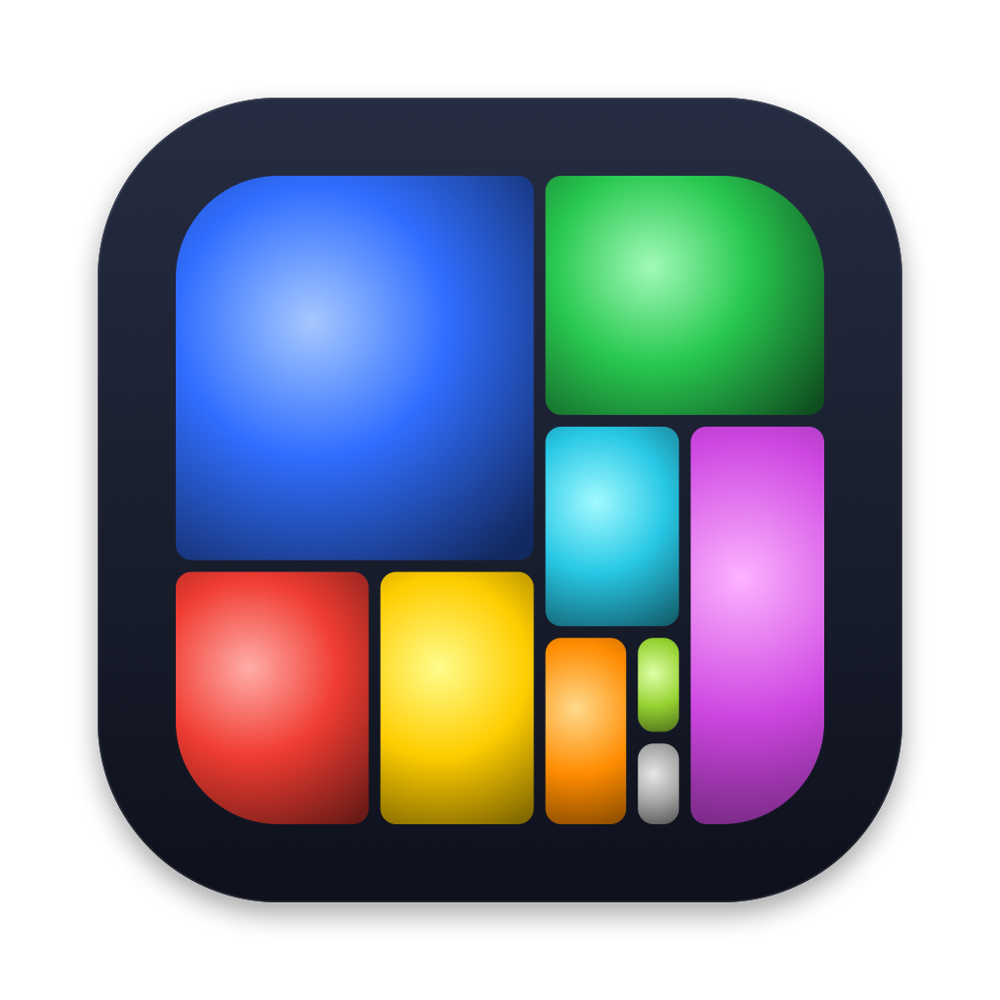
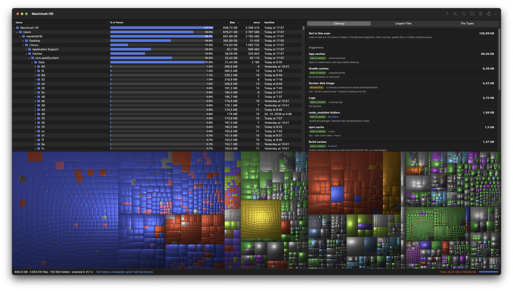

# DirectStat

A disk usage viewer for macOS: see which folders fill your disk and what is safe to delete.
Native SwiftUI + AppKit, no dependencies.



## Why

When the disk is full, you need answers to two questions: *which folders are big*, and *what can I safely delete*.
DirectStat answers both in one window: a folder tree sorted by size, a treemap, and file types side by side,
plus a **Cleanup** list that recognizes caches and build output and says which are safe to delete.
It also shows how much used space no folder accounts for. Free, open source, and native on Apple Silicon.

## Features

- **Folder tree** sorted by size, with a "% of parent" bar, size and item count
- **Treemap** with cushion shading, colored by file type. Click to select, hover for path and size
- **Cleanup** tab: finds known space hogs (Xcode DerivedData, caches, `node_modules`,
  Docker image, Gradle/npm/Maven caches, iPhone backups, Trash…), labeled "Safe to delete" or "Review first"
- **Largest Files** and **File Types** tabs
- **Not in this scan**: on whole-disk scans, shows used space no folder accounts for (snapshots, system, no access)
- Move to Trash or delete permanently, with the tree and treemap updated in place
- Fast parallel scanner (`getattrlistbulk`), sizes match `du` (allocated bytes, hard links counted once)

## Build and run

```sh
./scripts/build-app.sh          # creates build/DirectStat.app
open build/DirectStat.app
```

Requires macOS 15 and Xcode (or the Swift 6 toolchain).

To scan everything, add `build/DirectStat.app` in **System Settings › Privacy & Security › Full Disk Access**.
The app is ad-hoc signed, so macOS may ask again after a rebuild.

## Command line

```sh
swift run -c release directstat-cli ~ --top 10 --depth 2 --png treemap.png
```

Prints the largest folders, largest files, file types and cleanup suggestions.

## Layout

| Path | What |
|---|---|
| `Sources/DirectStatCore` | Scanner, tree model, treemap layout/renderer, cleanup rules |
| `Sources/DirectStat` | The Mac app (SwiftUI, with an `NSOutlineView` for the tree) |
| `Sources/directstat-cli` | Command-line version |
| `Tests/DirectStatCoreTests` | `swift test` |

Dev flags for the app: `--scan <path>` starts a scan on launch; `--snapshot out.png --snapshot-after 10`
saves a picture of the window and quits.
